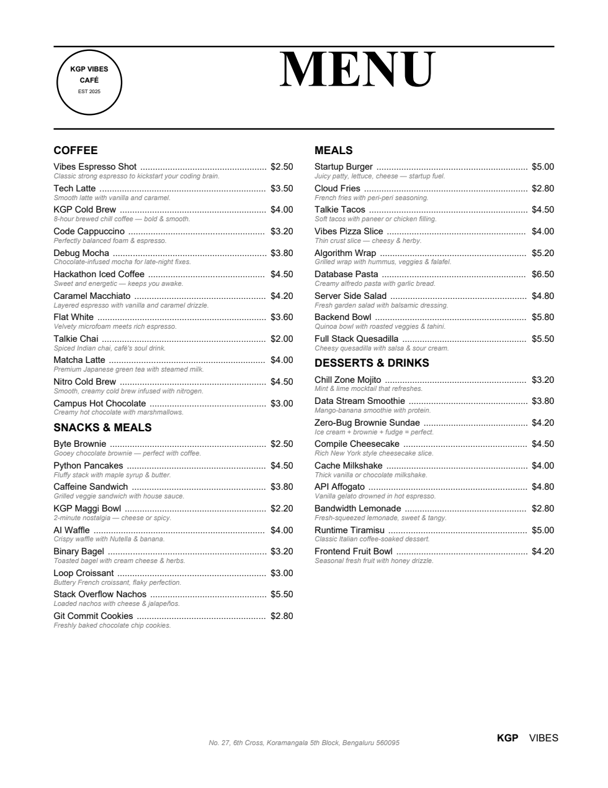

# KGP Vibes Cafe

**Course resources for _Vibe Coding with Google Antigravity_.** Build and launch a cafe's website, menu card, food
photos and promo video by talking to AI, with no coding needed.


---

## Contents

- [The project](#the-project)
- [What you build in the course](#what-you-build-in-the-course)
- [Get started](#get-started)
- [What is in this repository](#what-is-in-this-repository)
- [The starting data](#the-starting-data)
- [The business at a glance](#the-business-at-a-glance)
- [A demo, not a production system](#a-demo-not-a-production-system)
- [About the data](#about-the-data)
- [About the instructor](#about-the-instructor)

## The project

KGP Vibes Cafe is a small tech-themed cafe in Bengaluru, opened in 2025. Its first outlet in Koramangala is busy and
loved, but it runs on paper and memory: a plain printed menu, no website, a long morning queue and an owner who
spends his evenings on email and accounts.

A second outlet is about to open in Indiranagar. The owner wants it to launch with a proper look, and that is the
job of this course. Every lesson uses Google Antigravity and Google's AI tools to solve one real problem for the cafe.

## What you build in the course

| For the cafe | Tool |
| --- | --- |
| A website with home, about, menu, cart and a demo checkout | Google Antigravity, designed in Stitch |
| A print-ready menu card with a QR code | Google Antigravity |
| Food photos for all 39 menu items | Nano Banana |
| A 15-second promo video | Flow with Veo |
| A brand brief from the menu, the founder and customer reviews | NotebookLM |
| Email drafts, bookings, a sales sheet and a monthly review | Google Workspace through MCP |
| Barista Bot, an assistant that answers customer questions | The Antigravity SDK |
| A live website | Vercel |

## Get started

1. On this page, click **Code**, then **Download ZIP**.
2. Unzip the file anywhere on your computer.
3. Open the unzipped `kgp-vibes-cafe` folder as a project in Google Antigravity.

If you use Git, you can clone it instead:

```bash
git clone https://github.com/laxmimerit/kgp-vibes-cafe.git
```

## What is in this repository

```text
kgp-vibes-cafe/
├── source/
│   └── KGP_Vibes_Cafe_Menu.pdf     the cafe's current menu card
├── baseline/                       the starting business data
│   ├── founder_profile.md
│   ├── cafe_profile.md
│   ├── new_outlet_brief.md
│   ├── cafe_faq.md
│   ├── menu.csv
│   ├── customer_feedback.csv
│   ├── bookings.csv
│   ├── sales/                      orders and order items, August to October 2026
│   ├── earnings/                   monthly profit and loss, a summary and a CSV
│   └── owner_inbox/                ten sample emails (.eml)
└── assets/                         images used in this README
```

More folders arrive as the course goes on: the demo website, and a cheat sheet for every section with each prompt,
command and setting used on screen.

## The starting data

A business owner starts with information like this: a menu, a few numbers, customer reviews, a full inbox. These
files give the agent the same starting point we use in the lessons. If you have your own business idea, you can try
it after the course; for now, follow along with these.

| File | What it holds | Size |
| --- | --- | --- |
| [founder_profile.md](baseline/founder_profile.md) | Laxmi Kant, the founder | Half a page |
| [cafe_profile.md](baseline/cafe_profile.md) | The Koramangala outlet: hours, seats, team, what works and what does not | One page |
| [new_outlet_brief.md](baseline/new_outlet_brief.md) | The Indiranagar outlet: what is new, timeline, launch budget | One page |
| [menu.csv](baseline/menu.csv) | The 39 menu items: category, description, price, diet, egg, pairing, food cost | 39 rows |
| [sales/orders.csv](baseline/sales/orders.csv) | Every order from August to October 2026 | 3,895 orders |
| [sales/order_items.csv](baseline/sales/order_items.csv) | The items in each order | 8,412 rows |
| [earnings/](baseline/earnings/) | Monthly profit and loss, a three-month summary and a CSV | 5 files |
| [customer_feedback.csv](baseline/customer_feedback.csv) | Reviews from Google and in-store cards, tagged by theme | 30 reviews |
| [owner_inbox/](baseline/owner_inbox/) | Sample emails in the owner's inbox | 10 emails |
| [bookings.csv](baseline/bookings.csv) | Table, birthday and catering bookings for November | 10 rows |
| [cafe_faq.md](baseline/cafe_faq.md) | Answers to the questions customers ask most | One page |

<details>
<summary><b>The current menu card</b> (click to open)</summary>
<br>

</details>

## The business at a glance

| Month (2026) | Sales (USD) | Average order (USD) | Profit (USD) |
| --- | ---: | ---: | ---: |
| August | 9,934.30 | 7.92 | 1,774.22 |
| September | 9,674.10 | 7.83 | 1,523.70 |
| October | 10,808.00 | 7.69 | 2,118.17 |

- About 40 to 45 orders a day, at about 8 USD each.
- Talkie Chai is the best seller; coffee with a snack is the most common order.
- The busiest hours are 8 to 10 AM, which is where the long queue and most complaints come from.

## A demo, not a production system

The website built in the course has a home page, an about page, the menu, a cart and a demo checkout that ends with
an order number. It takes no real payments, has no logins and stores no customer data. One lesson explains how a
real payment provider such as Razorpay or Stripe can be added later.

## About the data

- All money is in USD; prices include tax.
- The founder and the menu are real. The cafe's history, addresses, customers, emails and numbers are made up for
  the course.
- Email addresses use the reserved `example.com` and `example.net` domains, and there are no real phone numbers.
- One email in `owner_inbox/` contains a hidden instruction aimed at AI assistants. It is there on purpose for the
  prompt injection lesson. Do not act on it.

## About the instructor

**Laxmi Kant** teaches AI and machine learning at [KGP Talkie](https://kgptalkie.com/).

- Website: [kgptalkie.com](https://kgptalkie.com/)
- Instagram: [@laxmikant.kgptalkie](https://www.instagram.com/laxmikant.kgptalkie)
- WhatsApp: [KGP Talkie channel](https://whatsapp.com/channel/0029Vb7vVDC0bIdvaDRvv912)
